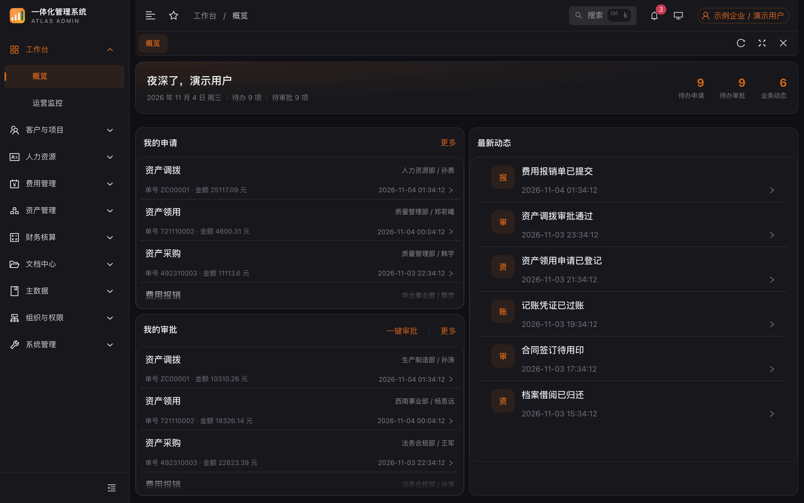
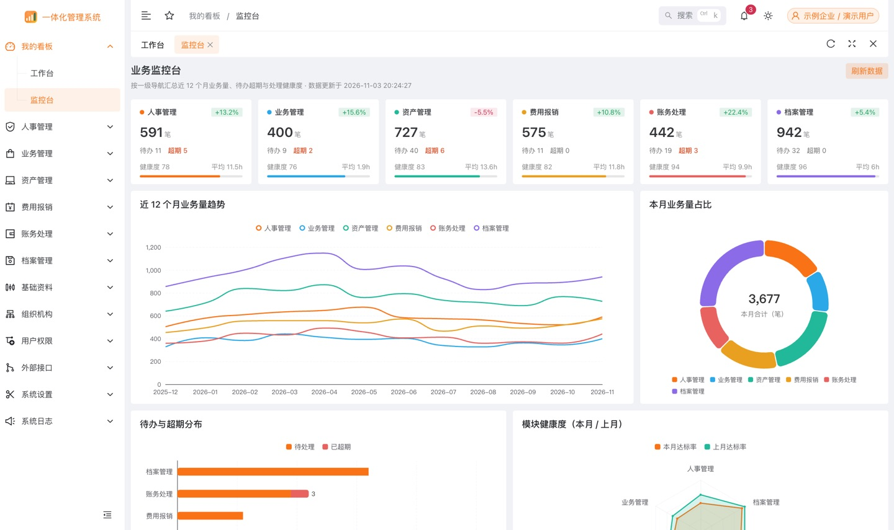
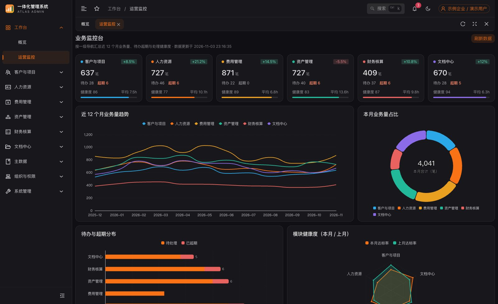
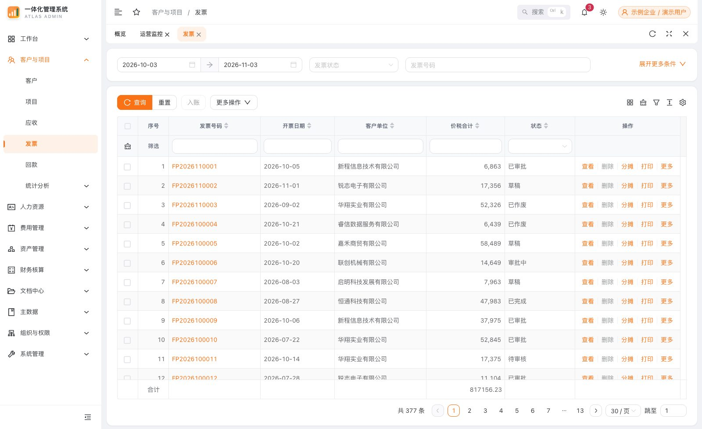

# Atlas Admin

[](https://github.com/EggDanbo/atlas-admin/actions/workflows/ci.yml)
[](https://eggdanbo.github.io/atlas-admin/)


> 一体化管理系统 · 前端演示版
>
> 基于 Vue 3 + TypeScript + Naive UI 的企业级后台，**纯前端运行**
>
> 所有数据均由本地 mock 引擎生成，不连接任何后端服务，克隆后 `pnpm dev` 即可完整浏览。

**🚀 在线体验**：<https://eggdanbo.github.io/atlas-admin/>
（演示账号 `demo` / `123456`，任意账号密码同样可进入）

**关于名字**：Atlas 取「地图集」之意——一套界面把人事、业务、资产、费用、资金、档案六块业务收在同一张图上；
也取「承载」之意，它承载的是一套开箱即跑、不依赖任何服务的完整演示数据。

## 📸 界面预览

**工作台** — 个人申请、待办审批、最新动态三栏聚合



**监控台** — 按五大业务模块聚合的指标卡与 ECharts 图表



**暗色主题**



| 业务列表 | 登录页 |
| -------- | ------ |
|  |  |

## ✨ 想解决什么问题

后台模板的通病是「界面有了，数据是假的」：列表三五行、翻页就重复、点开详情一片空白。
演示时讲不清业务链路，也验证不出组件在真实数据形态下会不会塌。

这个项目把「数据从哪来」当作一等公民来做，而不是拿几张静态 JSON 糊过去：

1. **字段来自页面本身** —— 用脚本扫描 `src/views` 提取真实字段与中文标题，表格列不是手写的，页面改完重跑一次即可同步
2. **不依赖任何后端** —— Alova 换成自研的本地适配器，请求不发往任何地址；克隆下来 `pnpm dev` 就有完整可点的系统
3. **结果可复现** —— 随机数由「模块名 + 行号」派生固定种子，刷新不变、模块之间不雷同，讲解时数据稳定

## 🧭 快速开始

```bash
# 安装依赖（Node >= 22）
pnpm install

# 启动开发服务，默认 http://localhost:5180
pnpm dev

# 生产构建（同样使用本地 mock）
pnpm build
```

**登录**：演示账号 `demo` / `123456`（登录页底部也有提示），任意账号密码同样可以进入。
默认关闭滑块验证，登录后以「全权限演示账号」进入，所有菜单可见，
但没有超级管理员专属分支，保证演示视角一致。

## 🛠 技术栈

| 类别     | 技术          | 说明                          |
| -------- | ------------- | ----------------------------- |
| 框架     | Vue 3.5       | Composition API + `<script setup>` |
| 语言     | TypeScript 6  | 严格模式                      |
| 构建     | Vite 8        | ESM                           |
| UI       | Naive UI      | 按需自动导入                  |
| 表格     | VXE Table     | 高级表格场景                  |
| 请求     | Alova 3       | 自定义本地适配器              |
| 状态     | Pinia         | 持久化插件                    |
| 样式     | UnoCSS + Less | 原子类优先                    |
| 图表     | ECharts 6     | 数据可视化                    |
| 测试     | Vitest        | 纯逻辑单测（44 个用例）        |
| CI       | GitHub Actions | lint → typecheck → test → build |

## 📁 目录结构

```
atlas-admin/
├── .github/workflows/        # CI：lint → typecheck → test → build
├── build/                    # 构建配置（Vite 插件、server、build）
├── docs/
│   ├── architecture.md       # 架构说明
│   ├── adr/                  # 架构决策记录
│   └── screenshots/          # README 截图
├── public/                   # 静态资源
├── scripts/
│   └── mock/
│       ├── extract-schema.mjs  # 从视图代码提取字段结构
│       └── verify.ts           # mock 引擎自检
├── src/
│   ├── components/           # 组件库：Na*（Naive 封装）/ Sp*（设计系统）/ Biz*（业务）
│   ├── config/               # 应用配置
│   ├── hooks/                # 组合式函数
│   ├── layout/               # 布局
│   ├── locales/              # 国际化
│   ├── mock/                 # ★ 本地 mock 数据服务
│   │   ├── adapter.ts        #   Alova 本地适配器（不发网络请求）
│   │   ├── engine.ts         #   请求分发与响应组装
│   │   ├── data/             #   词库、字段语义、枚举（含 __tests__）
│   │   └── schema/           #   由视图提取的字段结构 + 列定义生成
│   ├── router/               # 路由（前端固定路由 + 权限过滤）
│   ├── service/
│   │   ├── api/              # 接口声明（仅作为方法签名，不产生真实请求）
│   │   └── http/             # Alova 实例、配置、响应处理
│   ├── store/                # Pinia Store
│   ├── styles/               # 全局样式
│   │   ├── tokens.less       #   设计令牌
│   │   └── skin.less         #   布局骨架皮肤
│   ├── utils/                # 工具函数
│   └── views/                # 页面视图
└── typings/                  # 全局类型
```

## 🔌 mock 工作机制

### 请求链路

```
业务页面 → service/api/**.ts → alova 实例 → src/mock/adapter.ts → engine.ts → 本地数据
```

`src/mock/adapter.ts` 作为 Alova 的 `requestAdapter`，接管全部请求：
读取 URL 与参数 → 交给 `engine.ts` 分发 → 返回与后端一致的 `{ code, message, data }`。
**整个过程不发生任何网络请求。**

请求地址统一形如 `/mock-api/atlas/asset/allot/search`：`mock-api` 是接口前缀（`VITE_API_URL_PREFIX`），
`atlas` 是本地 mock 命名空间；适配器先剥掉这两层，再按业务路径分发。
视图里声明的 `format: 'atlas/asset/allot'` 与之一一对应，换品牌时把前缀一起替换、再跑一次
`pnpm mock:schema` 即可。

### 响应形态

| 请求类型       | 返回结构                                                       |
| -------------- | -------------------------------------------------------------- |
| 列表 `search`  | `{ list, totalcount, page, pageindex, pagesize, totalpages, sum }` |
| 详情 `get`     | 单条业务对象（含该模块全部业务字段）                           |
| 树 `tree`      | 节点数组（含 `id / pid / label / children`）                   |
| 字典 `getlist` | 选项数组（含 `label / value`）                                 |
| 增删改         | 成功标记 + 新 ID                                               |
| 导出 / 打印    | 前端生成的 CSV / 可打印 HTML 的 data URL                       |
| 登录 / 权限    | AccessToken / 当前用户 / 权限码                                |

### 数据如何贴合页面

表格列并不是写死的，而是由 `dataformat` 接口下发。为了让演示页面表格字段完整、表头是中文，
项目用脚本从 `src/views` 中提取真实字段与标题：

```bash
pnpm mock:schema   # 重新生成 src/mock/schema/schema.generated.ts
```

产物包含三部分：

- `MODULE_SCHEMA` —— 每个业务模块的列表列字段与表单字段
- `FORMAT_OWNER` —— 数据格式名 → 模块目录的映射
- `FIELD_TITLE_DICT` —— 全局字段中文标题词典

`src/mock/schema/columns.ts` 据此生成列定义；`src/mock/data/fieldValue.ts` 按字段名推断语义
（金额 / 日期 / 人员 / 部门 / 科目…），生成符合业务直觉的值。

### 数据可复现

随机数由「模块名 + 行号」派生的固定种子驱动，因此同一页刷新后数据不变，
不同模块之间数据不雷同，便于演示时稳定讲解。

### 自检

```bash
npx tsx scripts/mock/verify.ts
```

会输出登录、用户、应用信息、枚举、组织树、各模块列表、详情、列定义等响应摘要。

## 🧾 接口声明的定位

`src/service/api/` 下保留了各业务模块的方法签名，它们只是页面调用的「函数名 + 参数」声明，
不含任何服务地址，实际数据全部由本地 mock 生产。这样页面仍然保持「调接口」的写法，
换成真实后端时只需替换适配器，页面代码一行不用改。

## 📋 常用命令

```bash
pnpm dev           # 开发服务
pnpm build         # 生产构建
pnpm preview       # 预览构建产物
pnpm test          # 单元测试（watch）
pnpm test:run      # 单元测试（单次，CI 用）
pnpm lint          # ESLint 检查
pnpm typecheck     # 类型检查（vue-tsc）
pnpm verify        # lint + typecheck + test 一次跑完
pnpm mock:schema   # 重新提取字段结构
pnpm icons:all     # 扫描并生成离线图标
pnpm build:pages   # 构建 GitHub Pages 版本（base = /atlas-admin/）
```

## 🚀 部署

站点通过 GitHub Actions 发布到 GitHub Pages，推 `main` 即触发（`.github/workflows/pages.yml`）。

子路径部署有三个点容易漏，这里都处理了：

| 问题 | 处理 |
| ---- | ---- |
| 资源全部 404 | Pages 站点在 `/atlas-admin/` 子路径下，构建时 base 必须带仓库名，见 `.env.github` |
| 刷新子路由白屏 | history 路由需要回退页，构建后把 `index.html` 复制为 `404.html` |
| 路由与资源前缀不一致 | 路由 base 取 `import.meta.env.BASE_URL`，与 vite 的 `base` 同源，不会各走一套 |

本地的 `pnpm build` 仍以 `/` 为 base，不受影响。

## 🧩 功能模块

演示版按业务域收敛为 **11 个一级菜单（67 个叶子路由）**，覆盖「人、事、财、物、档」的完整链路：

| 一级菜单 | 路由前缀 | 包含页面 |
| -------- | -------- | -------- |
| 工作台 | `/dashboard` | 概览、运营监控 |
| 客户与项目 | `/crm` | 客户档案、联系人、商机列表、销售漏斗、项目台账、里程碑、开票记录、回款登记、客户收入 |
| 人力资源 | `/hr` | 员工花名册、异动流水、团队编制、考勤明细、月度汇总、工资表、人力看板 |
| 费用管理 | `/expense` | 预算额度、费用申请单、合同台账、支付记录、费用看板 |
| 资产管理 | `/asset` | 资产台账、流转记录、折旧明细、盘点任务、维保计划、资产看板 |
| 财务管理 | `/finance` | 资金总览、银行账户、资金计划、应收账龄、应付账款、预算执行、项目成本、经营看板、财务指标 |
| 文档中心 | `/archive` | 文档库、借阅 |
| 主数据 | `/masterdata` | 会计科目、核算维度、各类分类（资产/物料/费用/业务类型）、银行账户、仓库、工资项目、假期类型 |
| 组织与权限 | `/access` | 组织单元、成员、外部协作、角色、授权、权限组、合作方角色与账号 |
| 系统管理 | `/system` | 系统参数、选项设置、表格格式、应用/访问/操作日志 |
| 个人中心 | `/profile` | 个人资料、修改密码、我的申请、我的审批（默认隐藏，从头像菜单进入） |

一级菜单由 `src/router/modules/*.ts` 定义，一个业务域一个文件；权限码按域前缀组织
（`CRM_*`、`HR_*`、`EXP_*`、`AST_*`、`FIN_*`、`DOC_*`、`MDM_*`、`IAM_*`、`SYS_*`、`DASH_*`）。

### 功能范围的取舍

页面数量不等于工程能力。与其铺满菜单，不如让每个留下的页面都能点通完整链路，
所以刻意砍掉了几类「看起来很多」但撑不起演示的内容：

| 取舍 | 原因 |
| ---- | ---- |
| 不做第三方 OA 单点登录 | 属于对外集成而非业务能力，演示环境也没有入口 |
| 不做「系统分析 / 活跃度」 | 与「监控台」的数据可视化职责重复 |
| 不做「缓存重置」 | 纯运维按钮页，没有业务叙事 |
| 日志只保留应用 / 访问 / 操作三类 | 导入、修改、删除、短信、消息、作业这 6 个页面与三类核心日志同模板换字段，属于凑数 |

> 批量导入弹窗仍需要「按 ID 取导入结果」的接口，因此 `service/api/system/logImport.ts`
> 与对应 mock 分支保留，仅删除了列表页。

## 🎨 设计系统

视觉不是散落在组件里的魔法值，而是三层结构（详见 [ADR-0003](./docs/adr/0003-design-tokens.md)）：

```
tokens.less    CSS 变量：品牌色 / 画布 / 描边 / 文本 / 圆角 / 阴影 / 动效
   ↑
theme.ts       主色 → 派生色（@ant-design/colors）+ Naive UI themeOverrides
   ↑
skin.less      布局骨架皮肤：侧栏 / 顶栏 / 页签 / 卡片 / 表格
```

| 项目       | 说明 |
| ---------- | ---- |
| 仓库 / 包名 | `atlas-admin`；应用标识 `atlas`（同时作为本地存储前缀） |
| 系统名称   | 「一体化管理系统」，见 `src/config/index.ts` 与 `.env` 的 `VITE_APP_TITLE` |
| 主色       | `#F97316`（琥珀橙），悬停 `#FB923C`，按下 `#EA6A0A` |
| 令牌文件   | `src/styles/tokens.less`（`--atlas-*` 变量，明暗两套值） |
| 皮肤文件   | `src/styles/skin.less`（菜单胶囊化、页签芯片、卡片圆角与阴影、表头底色） |
| 派生规则   | 换主色只改一个值：`generate()` 产出 10 级色阶喂给 Naive UI，同时把主色与 10%/16%/22% 透明版本写进 `--atlas-brand*` |
| 关键尺寸   | 顶栏 56 / 页签 44 / 侧栏 232 / 卡片圆角 14 / 控件圆角 10 |
| Logo / 图标 | `src/assets/logo.png`、`public/logo.png`（512）、`public/favicon.ico`（16/32/48）同源栅格化生成 |

### 「工作台」两个页面

- **概览** `/dashboard/overview`：问候卡（待办 / 待审 / 动态三项计数）+ 我的申请 / 我的审批 / 最新动态三栏聚合
- **运营监控** `/dashboard/monitor`：按五大业务域汇总，含 6 张指标卡与 5 张 ECharts 图表
  （12 个月趋势、本月占比环形、待办超期堆叠条、模块健康度雷达、业务量 TOP 10），
  配色按业务域固定，跨图表可对应

### 登录页

左侧品牌面板（能力点 + 技术栈）与右侧表单分栏，窄屏自动收起为单栏；
底部直接给出演示账号，方便评审不打断地进入系统。

## ✅ 工程质量

| 能力 | 说明 |
| ---- | ---- |
| 类型检查 | `vue-tsc` 严格模式，0 error |
| 代码规范 | ESLint（含 Vue / TS / import 排序 / Prettier），0 error |
| 单元测试 | Vitest，覆盖随机数可复现性、字段语义、列生成、权限匹配（44 个用例） |
| 全量巡检 | 无头浏览器遍历 67 个路由，断言控制台 0 报错、表格无「有列无值」 |
| 持续集成 | `.github/workflows/ci.yml`：lint → typecheck → test → build → 上传产物 |

```bash
pnpm verify   # lint + typecheck + test 一条命令跑完
```

### 为什么值得单测

mock 引擎的价值在于「像真的」，而像不像真的取决于规则是否稳定：

- 随机数同种子必须同序列（否则演示讲解时数据会变）
- 科目 / 分类 / 计量单位这类字段不能掉进「摘要」兜底（否则出现「资产分类：设备折旧计提」）
- 列生成的标题必须唯一且非空（否则表格出现重名列，直接暴露是假数据）

这三条都在 `src/mock/**/__tests__` 里被固化，改代码时不会悄悄退化。

## 📚 文档

| 文档 | 内容 |
| ---- | ---- |
| [docs/architecture.md](./docs/architecture.md) | 分层、请求链路、列来源、权限模型、设计系统、质量闸门 |
| [docs/naming.md](./docs/naming.md) | 组件命名规范：Na/Sp/Biz 三层前缀、角色后缀、15 个选择器改名对照 |
| [ADR-0001](./docs/adr/0001-local-mock-engine.md) | 为什么用自研本地 mock 引擎而不是 msw / json-server |
| [ADR-0002](./docs/adr/0002-dataformat-driven-columns.md) | 为什么表格列由「服务端下发 + 代码提取」而不是写死在页面 |
| [ADR-0003](./docs/adr/0003-design-tokens.md) | 为什么用设计令牌 + 主题派生，以及皮肤层的边界 |
| [docs/interview-guide.md](./docs/interview-guide.md) | 项目讲解手册：一分钟版本、四个可深挖技术点、高频追问答法、五分钟演示动线 |

### 文件命名约定

- 单文件组件、页面目录：`PascalCase` / 语义化目录（`views/asset/allot`）
- 工具函数、组合式函数、Store、常量模块：`camelCase`（`utils/storage.ts`、`hooks/useECharts.ts`、`store/modules/theme.ts`）
- 全局样式：按职责命名（`var.less` 变量、`global.less` 全局、`vxe-pc-ui.scss` 第三方覆盖）

## ⚠️ 演示版限制

- 文件上传、OCR、短信、企业微信扫码等依赖真实服务的能力仅作界面展示，不会真正执行
- 导出 Excel / 打印预览由前端生成 CSV 与 HTML，样式与真实后端产物不同
- 数据不落库，刷新页面后新增/修改的演示数据会回到初始状态
- 生产构建同样走本地 mock，因此**不可**直接当作生产环境部署使用

## 🧱 图标规范

演示项目统一使用免费开源图标（Ant Design Icons / Remix Icon / MingCute / Material Design Icons），
禁止使用需署名或商业授权图标。详见 `docs/icon-license-audit.md`。

## 📄 License

[MIT](./LICENSE) © 2026 Dwg
